<!--
  Profile README for github.com/abdullahreda56643-sudo
  Upload this file AND the whole assets folder to the repository named exactly like your username.
  The images in assets/ are animated SVGs, GitHub plays the animations automatically.
-->


 

I build web platforms that replace spreadsheets and manual work. I'm a full-stack developer working mainly with **React** and **Laravel**, delivering platforms for clients in **Egypt and Saudi Arabia** across education, finance, recruitment, workforce management and CRM: requirements, architecture, API, interface and deployment. Freelancing under **Click Solutions** since 2024, and studying B.Sc. in Computer Science online at Thebes Academy (expected 2028).

**Looking for:** full-time, on-site Full-Stack, Laravel and React roles in Saudi Arabia (Riyadh, Jeddah, Dammam, Khobar). Ready to relocate on an employer-sponsored work visa and residency.

 

  

 

  

<table>
  <tr>
    <td width="50%"><a href="https://mqala.xyz"></a></td>
    <td width="50%"><a href="https://shiftcf.com"></a></td>
  </tr>
  <tr>
    <td width="50%"></td>
    <td width="50%"><a href="https://spark-platform.free.je/"></a></td>
  </tr>
  <tr>
    <td width="50%"><a href="https://hall-platform.site.je/"></a></td>
    <td width="50%"></td>
  </tr>
</table>

Spark and Hall are launched on starter domains chosen by the clients. Source for ShiftCF: <a href="https://github.com/abdullahreda56643-sudo/shift-management-system">shift-management-system</a>

 

  

 

  

 

  

<table>
  <tr>
    <td width="50%"></td>
    <td width="50%"></td>
  </tr>
</table>

 

  

  
  &nbsp;
  
  &nbsp;
  

 

