<!--
  Profile README for github.com/abdullahreda56643-sudo
  Upload this file AND the assets folder to the repository named exactly like your username.
-->

 

Full-stack developer working mainly with **React** and **Laravel**. I have been building production web systems as a freelancer since **2021** for clients in **Egypt and Saudi Arabia**, covering requirements, architecture, development, testing and deployment. Currently a freelance partner at **ClickSolutions** and a Computer Science student at Thebes Academy (expected graduation 2028).

 

  

 

  

<table>
  <tr>
    <td width="50%"></td>
    <td width="50%"></td>
  </tr>
  <tr>
    <td width="50%"></td>
    <td width="50%"></td>
  </tr>
  <tr>
    <td width="50%"></td>
    <td width="50%"></td>
  </tr>
</table>

 

  

 

  

 

  

<table>
  <tr>
    <td width="50%"></td>
    <td width="50%"></td>
  </tr>
</table>

 

  

  
  &nbsp;
  
  &nbsp;
  

 

