


  
  
  

  
  
  

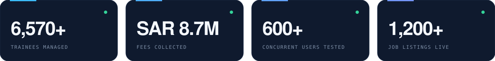

 

Full-stack developer working mainly with **React** and **Laravel**. I have been building production web systems as a freelancer since 2021 for clients in **Egypt and Saudi Arabia**, covering requirements, architecture, development, testing and deployment.

Currently a freelance partner at **ClickSolutions** and a Computer Science student at Thebes Academy (expected graduation 2028).

 

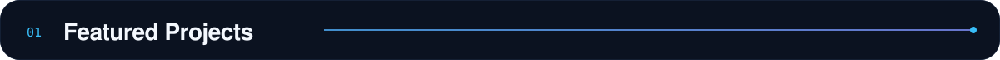

  

<a href="https://github.com/abdullahreda56643-sudo/UQTCollect">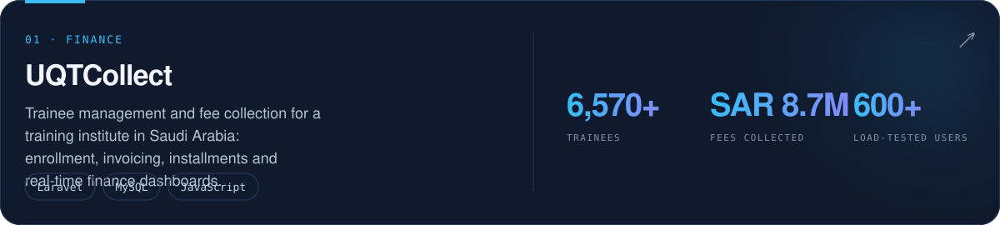</a>

<a href="https://mqala.xyz">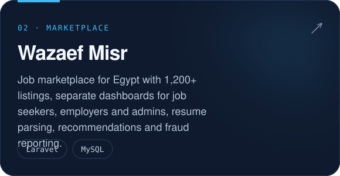</a>
<a href="https://github.com/abdullahreda56643-sudo/shift-management-system">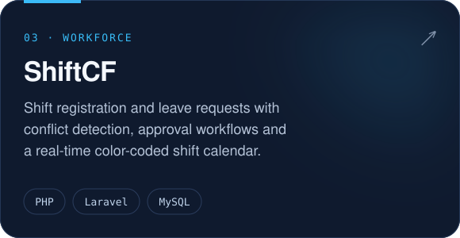</a>

<a href="https://spark-platform.free.je/">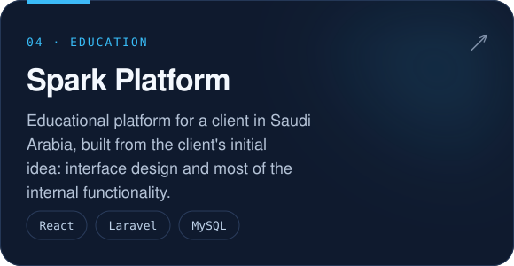</a>
<a href="https://hall-platform.site.je/">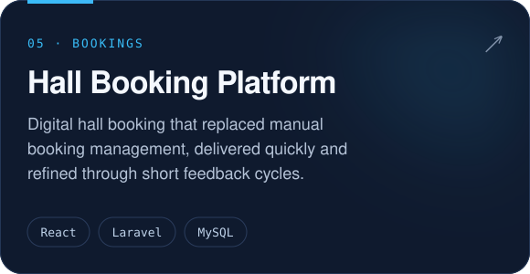</a>

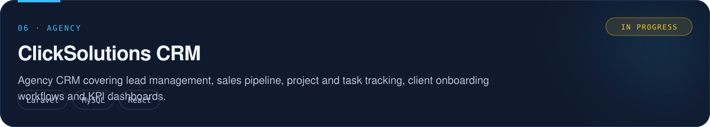

  

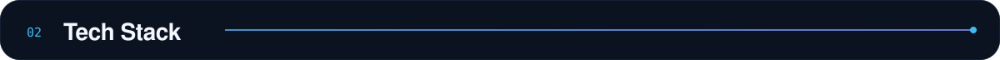

  

<b>CORE</b> 

<b>TOOLS</b> 

<b>WORKING KNOWLEDGE</b> 

I also use AI tools (Claude, ChatGPT, Gemini, Cursor) to speed up development, and I review everything they produce before it ships.

  

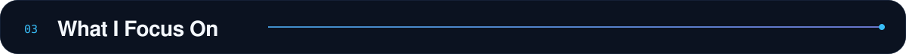

  

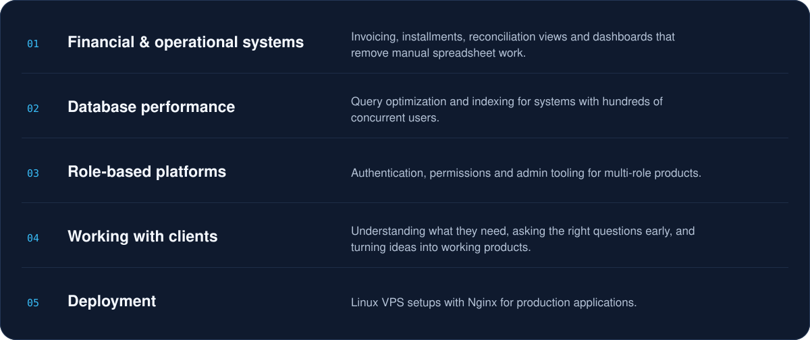

  

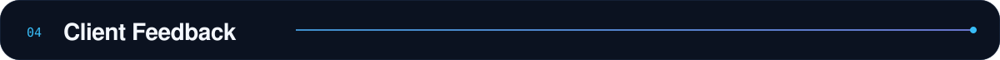

  

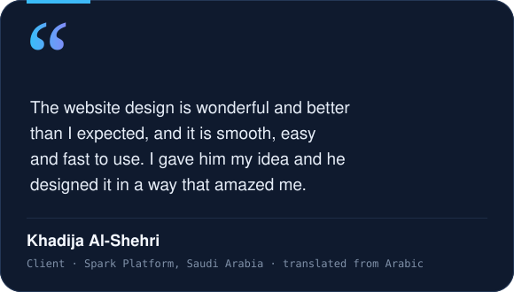
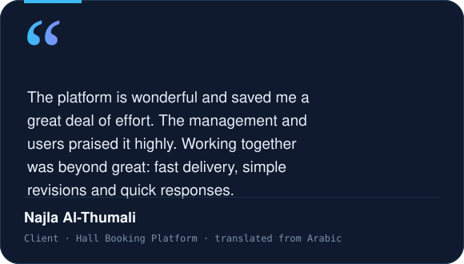

  

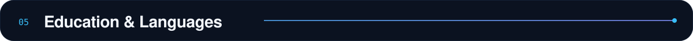

  

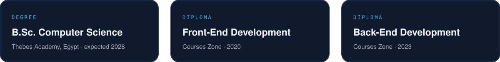

Languages: Arabic (native) · English (intermediate)

  

